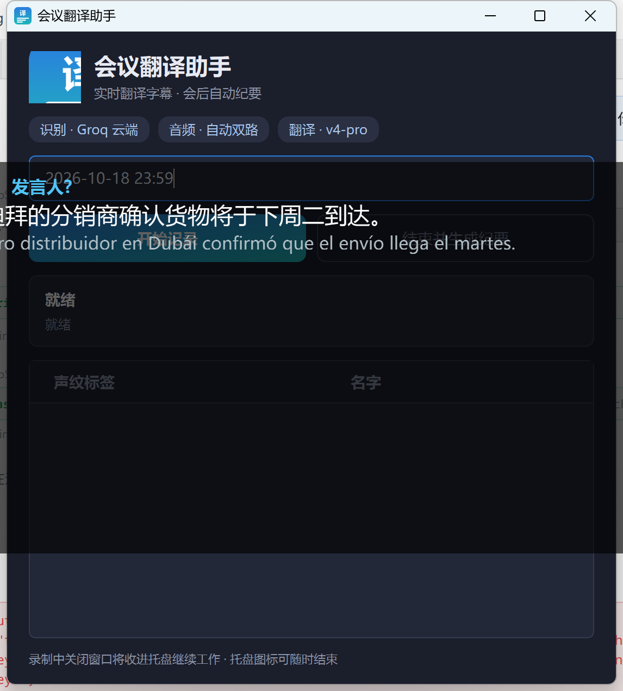
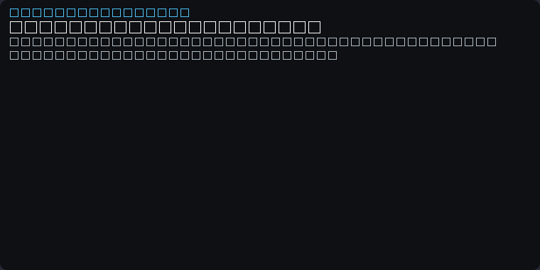

# 会议翻译助手（Meeting Bot）

本地运行的会议实时翻译工具：把电脑能"听到"的一切声音 —— 线上会议里对方的话、你自己说话、现场面对面对话 ——
**实时识别并翻译成中文字幕**，会后自动生成**双语逐字稿**和**中文会议纪要**。

> 仅支持 **Windows 10/11**（使用 WASAPI 系统声音回环采集，无需虚拟声卡）。

## 界面预览

| 主窗口 | 实时字幕（按说话人分块 / 中英对照） |
|---|---|
|  |  |

## 功能

- **自动双路采集**：同时捕获「系统播放的声音」+「麦克风」，线上会议/现场对话不用切换模式
- **多语种自动检测**：英语、西班牙语等自动识别，统一翻译成中文；中文发言直接显示原文
- **低延迟字幕**：云端识别（Groq whisper-large-v3-turbo）约 3~5 秒出字幕；本地识别模式 30~55 秒（零成本、不出本机）
- **Teams 转录式字幕面板**：按说话人回合分块、原文+译文段落化显示；窗口可拉伸，字号随窗口自动缩放（滚轮调节）
- **两阶段显示**：识别完先出原文，翻译完成后原地替换为中文（流式逐字出现）
- **带上下文的翻译**：自动参考前几句内容，统一术语/人名，修复口音导致的识别错字
- **防丢设计**：录制过程每句都追加写入 `会议记录/.recording/*.jsonl`；程序崩溃/断电后下次启动会提示「恢复上次会议」并自动生成逐字稿与纪要
- **会后产物**：`会议记录/<会议名>/逐字稿.md` + `纪要.docx`（讨论要点/结论/行动项/待跟进）
- **会后说话人标注**：配了 HuggingFace token 就自动在会议结束后把"谁说的"补进逐字稿和纪要（初版产物先出，标注完成后覆盖同名文件）
- **可选实时说话人区分**：录制期间每 60 秒跑一轮 pyannote（默认关闭，本机 CPU 标注慢于实时、标签有分钟级延迟）

## 安装（一键）

1. 安装 [Python 3.12](https://www.python.org/downloads/)（安装时勾选 **Add python.exe to PATH**）
2. 下载本仓库（Code → Download ZIP）并解压
3. 双击 **`install.bat`**，按提示填写 API Key（详见下一节）
4. 完成后桌面会出现「会议翻译助手」快捷方式，双击即用（只有界面，无命令行窗口）

> 首次使用会下载语音模型（约 500MB）。国内网络已自动配置 HuggingFace 镜像。

## 需要准备的 API Key

| Key | 是否必须 | 获取方式 |
|---|---|---|
| 翻译服务 API Key | ✅ 必须 | 任选一个 OpenAI 兼容服务：<br>· [DeepSeek 官方](https://platform.deepseek.com/)（推荐，便宜稳定）<br>· [OpenCode Go](https://opencode.ai/)（有 pi/opencode 账号可直接用）<br>· 通义/月之暗面/本地 Ollama 等自定义接口 |
| Groq API Key | 可选（推荐） | [console.groq.com](https://console.groq.com) 免费注册 → API Keys → 创建（`gsk_` 开头）。用于云端快速识别；不填则退回本地识别（慢但免费） |
| HuggingFace Token | 可选 | 仅"说话人区分"需要：注册 [huggingface.co](https://huggingface.co/settings/tokens) 创建 token，并在三个模型页点 Agree：[speaker-diarization-3.1](https://huggingface.co/pyannote/speaker-diarization-3.1)、[segmentation-3.0](https://huggingface.co/pyannote/segmentation-3.0)、[wespeaker-voxceleb-resnet34-LM](https://huggingface.co/pyannote/wespeaker-voxceleb-resnet34-LM) |

配置向导也可随时手动重跑：删除项目根目录的 `.env`，再执行 `install.bat`。

## 配置

`.env` 里的可调项都写在 `.env.example`（复制为 `.env` 后改）。纪要模板 `MINUTES_TEMPLATE` 三选一：

- `standard`：标准纪要——概要 → 讨论要点 → 结论 → 行动项 → 待跟进问题（默认）
- `action_first`：行动项优先——先出行动项（责任人 / 截止时间），再概要、要点、结论、待跟进问题；会后直接派人干活时用
- `bilingual`：中英双语——同一份纪要里每个字段「中文 / English」并列（标题也双语），有外方参会人时用

字幕显示模式也可以写在 `.env`：`SUBTITLE_MODE=bilingual`（中英对照，默认）/ `SUBTITLE_MODE=zh_only`（只显示中文）。字幕窗口右键切换过的选择会记住并优先于 `.env`。

本场术语 / 热词填窗口里「术语 / 热词」输入框（逗号分隔，只对本次录制生效）：会拼在 `.env` 的 `ASR_PROMPT` 前面一起喂给识别引擎。

## 使用

1. 双击桌面「会议翻译助手」→ 窗口 1 秒内出现（会议名默认按「年-月-日 时:分」自动生成，可手动改）
2. 点 **开始记录** → 字幕浮窗出现
   - 字幕面板：按说话人回合分块，译文整段显示、原文灰色小字跟随
   - 拖拽窗口可移动；拖边缘可缩放；滚轮调字号；向上翻看历史时暂停自动跟随，滚回底部恢复
   - **右键字幕窗口**可切换显示：`中文`（只显示译文）/ `中英对照`（默认，译文 + 灰色原文）；选择会记住，下次启动沿用（滚动位置不跳）
   - 主窗口「说话人」表格里改名会立刻更新整场已显示的字幕（已说过的话一并换名字，正文不动）
3. 会后点 **结束并生成纪要** → 在 `会议记录/` 下生成逐字稿与纪要
4. 关闭主窗口 = 退出程序（录制中关闭会确认：先结束录制并保存再退出）

## 会后说话人标注

会议里"谁在说话"是会后回看时最费劲的部分。开启后标注在**录制结束之后**离线做，不占会议期间的 CPU：

| 步骤 | 时间点 | 产物 |
|---|---|---|
| ① 录制落盘音频 | 录制全程 | `会议记录/.recording/rec_<时间戳>.wav`（16kHz 单声道，约 115MB/小时） |
| ② 初版产物导出 | 点「结束并生成纪要」后几秒 | `逐字稿.md` + `纪要.docx`（此时可能还没有说话人标签） |
| ③ 会后离线标注 | ②完成之后自动开始 | 同上两个文件**被覆盖**为带说话人版本 |

要求与代价：

- **需要 HuggingFace token**（`.env` 的 `HF_TOKEN` / 凭据管理器里那一项），且三个模型页已点 Agree（见上文「需要准备的 API Key」）；
- **需要录音文件**：`SAVE_AUDIO=true`（默认）。设成 `false` 时不会落盘音频，会后标注会自动跳过（状态栏提示一句）；
- **耗时约 0.5~1.5 倍会议时长**（1 小时会议约 30~90 分钟，视 CPU 而定），期间可以继续用电脑；状态栏显示「正在会后标注说话人…」，完成后提示「说话人标注完成，已更新逐字稿」；
- 标注失败（没 token、模型下载不下来、磁盘满等）**只告警**：②的初版产物原样保留，不会变空或损坏；
- 关掉这个能力：`.env` 设 `OFFLINE_DIARIZE=false`（实时标注 `DIARIZE_ENABLED` 是另一个开关，慢得多，默认关闭）。

## 常见问题

**Q：字幕要等多久？**
云端识别（Groq）下：说话结束约 2 秒先出原文，4~6 秒出中文译文。本地识别（`ASR_PROVIDER=local`）按 30 秒一批，延迟 30~55 秒。

**Q：翻译没反应 / 提示翻译失败？**
多半是翻译服务的 Key 过期或余额不足。重新运行 `setup_env.py` 写入新 key（存入 Windows 凭据管理器），或更新 `.env` 里的 `OPENCODE_API_KEY`（或你所用服务的 key）即可，无需重装。

**Q：Groq 限速了 / 断网了，会漏掉内容吗？**
不会（前提是本机本地识别模型可用）。云端识别（`ASR_PROVIDER=groq`）失败时（限速、断网、key 失效）会自动切到本地识别继续跑，字幕会比平时慢一些（本地按 30 秒一批），但内容不丢；切换当次只提示一句「已自动切换本地识别」。想彻底避免上传音频或不受云端额度影响，可在 `.env` 里设 `ASR_PROVIDER=local` 永久改用本地识别。

**Q：没有声音进入字幕？**
检查：① Windows 麦克风权限（设置 → 隐私 → 麦克风 → 允许桌面应用）；② 系统默认输入设备是否正确；
③ 想排查采集电平，可运行 `.venv\Scripts\python scripts\diagnose_mic.py`（60 秒录音诊断，逐层打点）。

**Q：说话人显示"发言人?"或标签乱？**
未配置 HuggingFace token 时无法区分说话人，属正常。配置 token 后，会议结束会自动在后台补标注并覆盖产物（见「会后说话人标注」）；若开着实时标注（`DIARIZE_ENABLED=true`），标签会有分钟级延迟。

**Q：能不能同时听系统声音和麦克风，会不会重复？**
默认自动双路。笔记本内置麦克风阵列通常带回声消除，会滤掉本机外放的声音，所以不会重复记录；用耳机时系统声音走回环、你的声音走麦克风，也互不影响。

## 隐私说明

- **音频**：仅在使用云端识别（Groq）时上传音频片段用于转写；使用 `ASR_PROVIDER=local` 时音频全程不出本机
- **文字**：外文原文会发送到你配置的翻译服务（用于翻译与生成纪要）
- **密钥**：存于 **Windows 凭据管理器**（Windows Credential Locker，服务名 `meeting-bot`），不写入项目文件；`.env` 只保留非敏感配置（接口地址、模型、语言、目录等）。老版本遗留在 `.env` 里的明文密钥可一键迁移：
  ```bat
  .venv\Scripts\python scripts\migrate_keys_to_keyring.py
  ```
  迁移脚本幂等，可反复运行。
- **本地存储**：所有记录/纪要保存在 `会议记录/` 目录；密钥不进 git，`.env` 已在 `.gitignore` 中
- **录音文件**：`SAVE_AUDIO=true`（默认）时整场音频只写在本机 `会议记录/.recording/`，仅用于会后说话人标注，不上传任何服务；不需要可设 `SAVE_AUDIO=false`
- 请遵守所在地区的数据合规要求，并在录音前征得参会人同意

## 目录结构

```
meeting_bot/            核心代码
  capture.py            音频采集（扬声器回环 + 麦克风，双路混合）
  vad.py                语音活动检测/切句
  asr.py                本地 faster-whisper / Groq 云端识别
  translator.py         翻译与纪要（OpenAI 兼容接口）
  recorder.py           录制编排（多线程 + 事件）
  subtitle.py           字幕浮窗（回合分块/可拉伸/自动缩放）
  app.py                主窗口与入口
  export.py             逐字稿 md + 纪要 docx
scripts/                诊断与辅助脚本
assets/app.ico          应用图标
tests/                  单元/集成测试（200+）
install.bat             一键安装
setup_env.py            交互式配置向导
```

## 技术栈

Python 3.12 · PyQt6 · faster-whisper · silero-vad · pyannote.audio（可选）· soundcard(WASAPI) ·
OpenAI 兼容 LLM 接口 · python-docx

## 许可

MIT License，见 [LICENSE](LICENSE)。
第三方模型遵循各自许可证（whisper 权重 MIT；pyannote 模型需在 HuggingFace 接受使用条款，不会被本仓库分发）。
